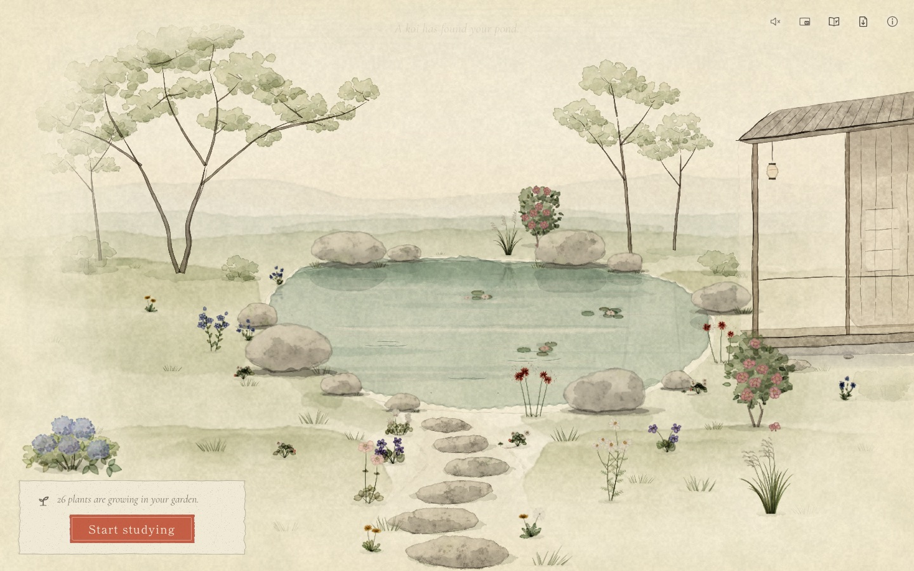
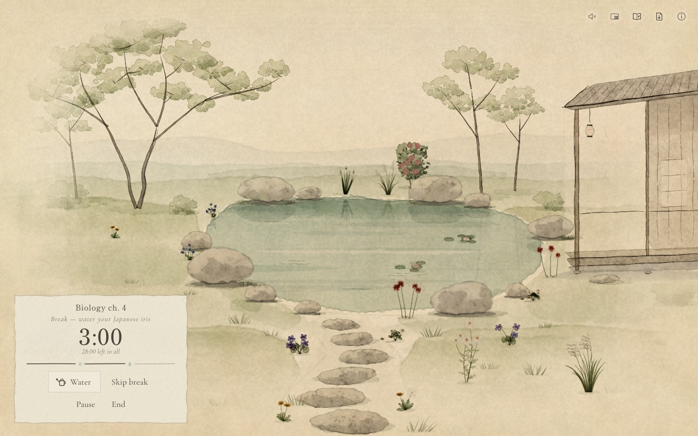
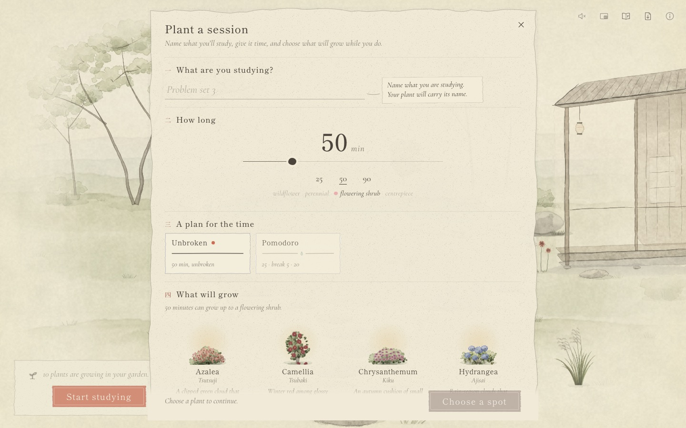

# Study Sprout

A study timer that grows a Japanese watercolour garden. Each study session is one plant. You
choose the plant when you start, and it grows from seed to full bloom while you work. Over many
sessions the garden fills, and wildlife slowly moves in: water striders first, then dragonflies,
koi, butterflies, birds and, much later, a grey heron.

Everything you see is painted in code at runtime: washes, wet edges, granulation and paper grain.
There are no image assets. Nothing shouts: no confetti, no streaks, no badges.

**Live:** <https://fanceapa1.github.io/Ssprout/> ·
**Studio** (every sprite, creature and effect, for art review): <https://fanceapa1.github.io/Ssprout/studio.html>



## How a session works

1. **Task**: name what you're studying ("Biology ch. 4"). The plant keeps that name forever.
2. **Time**: 10–180 minutes, with quick picks for 25, 50 and 90. Longer sessions unlock bigger
   plants: wildflowers, then perennials, flowering shrubs, and finally centrepiece trees.
3. **Plan**: Unbroken, or a plan with breaks inside the total (Pomodoro, Long focus, Deep work,
   Two deep blocks).
4. **Plant**: any species your time has earned. Higher tiers are visible but locked.
5. **Spot**: compatible spots glow (water, shore, meadow, path, far bank, rock crevice). Choosing
   an occupied spot replaces that plant; the old one is pressed into your herbarium.
6. **Grow**: the seedling grows live while you focus, and the garden glides in to look at it.
   Every 4–10 minutes of focus the watering can visits it on its own. **Breaks are for
   watering**: tap the can and it tilts, water falls in droplets, the soil darkens and the leaves
   lift. Skipping the water has no penalty. When the plan ends, the plant blooms and a quiet line
   says so. Ending early lets the seedling wither gently, and any plant it was replacing comes
   back.





## Features

- **The page.** The garden fills most of the window and dissolves into the paper below it. Under
  it, a dock reads in one order: **Study** (the session controls and the sessions in progress),
  **Your plant** (a large live painting of the plant you are growing), **Calendar** and **Garden
  tools**. A faint inked path continues the garden's stepping stones down past each section. On
  the garden itself only a small timer pill and the corner tools remain.
- **A living garden with real daylight.** Four painted phases follow today's sun where you are
  (guessed from the time zone, no permission asked): sunrise, midday, sunset and a moonlit night
  with a lit lantern. Each has its own sky, light, long or short shadows and rim light. Each
  session brings its own weather (sun, soft rain or mist), light motes and wind.
- **Parallel sessions.** Up to three sessions can grow at once, each with its own plant and spot.
  One is active; switching pauses the others, and paused time never counts.
- **Calendar and planning.** A daily, weekly or monthly view of what you studied, what is growing
  and what is planned. Plan a session once, daily, on weekdays or weekly; at its time it waits
  with a one-tap Start, and quietly passes if you let it.
- **Look closely.** Pinch, ctrl/⌘ + wheel, double-click or the + / − chips zoom up to 3×. Close
  views are painted again for the view, so they stay watercolour. Click any plant for its card:
  the species, its Japanese name, a note on its place in Japanese gardens, its poetic line and its
  own story (task, minutes, date).
- **Wildlife** that unlocks as the garden grows and behaves like animals: water striders,
  dragonflies, koi, butterflies, bees, small birds, a frog, swallows and a rare grey heron. Each
  new creature gets one quiet line the first time it is seen.
- **Floating timer** (Document Picture-in-Picture): a small painted card with your plant growing
  live, which can also switch sessions. Plus a tab-title countdown and a painted favicon.
- Notifications for breaks, back-to-focus, blooms and planned sessions while you are in another
  tab.
- **Sound**: procedural garden sounds (water, wind, distant birds, rain, a soft pour when the
  plant is watered, a bloom chime). **Muted by default.**
- Replaced plants are kept in the **Pressed Flowers** herbarium. Small hints disappear once you
  have used a feature; the ⓘ button lists them all.
- Export your garden to a JSON file and import it again. Everything lives in your browser's
  `localStorage`: there are no accounts and no server.
- Works on phones (touch, portrait framing) and respects `prefers-reduced-motion`.
- **Studio**: a page showing every sprite, creature, effect and paint primitive, for art review.

## Browser support

| | Chrome / Edge | Firefox | Safari |
|---|---|---|---|
| Garden, sessions, saving | ✔ | ✔ | ✔ |
| Floating timer window (Document Picture-in-Picture) | ✔ (116+) | — | — |
| Tab-title countdown and favicon | ✔ | ✔ | ✔ |
| Notifications | ✔ | ✔ | ✔ (on iOS only as a home-screen app) |

The app asks for notification permission gently, on your first session. It only notifies while
the tab is in the background. A closed tab cannot notify (there is no server), so a finished
plant simply waits for you. Timer ticks run in a Web Worker, so a background tab still finishes
on time. Automated tests run in Chromium only.

## Run locally

Requires Node 22+.

```sh
npm install
npx playwright install chromium   # once, for e2e tests and screenshots
npm run dev                       # http://localhost:5173/Ssprout/
```

| Command | What |
|---|---|
| `npm run dev` | dev server. `?dev` enables the debug API; `?dev&speed=60` runs time 60× faster. |
| `npm run build` / `npm run preview` | production build, and serving it |
| `npm run typecheck` | TypeScript |
| `npm test` | unit tests (Vitest) |
| `npm run e2e` | browser tests (Playwright, Chromium, 2 workers) against the production build; `E2E_PORT=4187` picks another port, `E2E_CLOCK=17:00` pins the time of day |
| `npm run shots` | screenshots into `artifacts/shots/` (see the header of `scripts/shots.ts`) |

The studio is at <http://localhost:5173/Ssprout/studio.html> in dev.

## Project structure

```
src/core      session rules, parallel sessions, plans, schedules, session log, persistence,
              controller (pure, unit-tested)
src/paint     the watercolour engine
src/render    renderer, layers, viewport and the camera
src/scene     the painted landscape and its 52 planting spots
src/plants    25 species, growth, sway, watering, wither, reflections, plant cards' notes
src/fauna     creatures and their schedules
src/ambience  weather, motes, wind, the daylight (sun times, phases, light plates)
src/ui        the page: stage overlay, dock, calendar, sheets, plant card, wayfinding
src/widget    floating timer, tab title/favicon, notifications, worker ticks
src/audio     procedural Web Audio
src/dev       the ?dev debug API used by tests and screenshots
src/studio    the studio page
tests/e2e     Playwright specs
docs/         specification, architecture, decisions, system docs, devlog
```

## How it's built

Vite and TypeScript, no framework. The garden is Canvas 2D, painted at runtime by a small
watercolour engine (`src/paint`); the interface is plain DOM over and below it. Plant sprites are
painted in Web Workers. Core rules are pure functions with unit tests; the browser behaviour is
tested with Playwright through a `?dev` debug API, never by waiting. Start with
[Architecture](docs/ARCHITECTURE.md), then the system doc of the part you are curious about.

## Documentation

- [Specification](docs/SPEC.md): what the product does.
- [Architecture](docs/ARCHITECTURE.md): modules and contracts.
- [Art direction](docs/ART_DIRECTION.md)
- [Testing](docs/TESTING.md): how it is tested, with a requirements → tests matrix.
- [Decisions (ADRs)](docs/adr/README.md)
- [System docs](docs/systems/)
- [Devlog](docs/devlog/README.md)
- [Roadmap](docs/ROADMAP.md)
- [Contributor onboarding](AGENTS.md)

Deployed to GitHub Pages from `main` after CI (typecheck, unit, e2e) passes.
